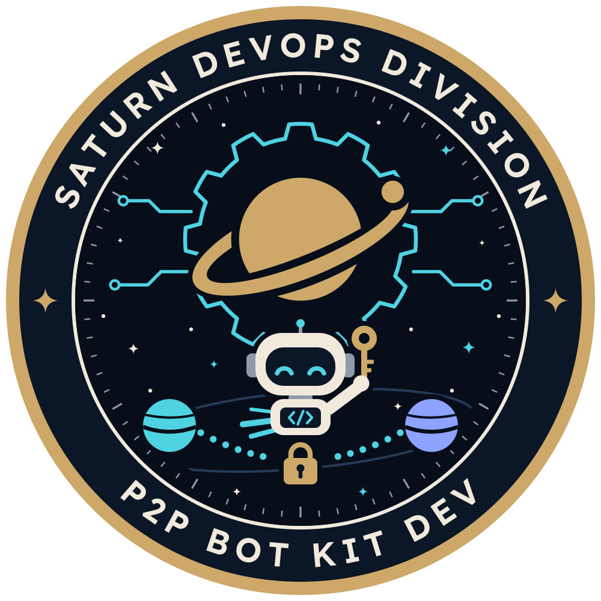

<p align="center">
  
</p>

# Saturn P2P bot kit

<p>
  <a href="LICENSE"></a>
  
  
</p>

A TypeScript kit for running your own maker or taker bot on the Saturn P2P
board: post offers and keep them listed, accept takes, take offers, and carry
each trade through its locks, claims and refunds on Phantasma and Base.

The bot runs on your machine, with your keys. Saturn never holds a key, never
trades for you and never runs a bot of its own: the board only lists offers
and relays messages. Liquidity on the board comes from people and their bots.

> **Use at your own risk.** The kit is open source under the MIT License
> (`LICENSE`) and comes as is, without warranty of any kind. You run it on
> your own machine with your own keys, and you alone are responsible for what
> it does, including any loss of funds ("Your keys, your risk" below).

## Try it in one command

Saturn's P2P board (https://ops.saturnx.cc/p2p) is where people trade
Phantasma tokens (TAZ, RA, SOUL, KCAL) for USDC on Base. Each trade is an
atomic swap: the seller locks its tokens on Phantasma and the buyer locks its
USDC on Base, both behind the hash of one secret. The seller's claim of the
USDC reveals the secret, which lets the buyer claim the tokens; a lock that
nobody claims goes back to its owner after its time limit.

On macOS or Linux, in a terminal:

```sh
git clone https://github.com/Infinite-Star-Studios/p2pbotkit.git && cd p2pbotkit && sh start.sh
```

No git? On GitHub, click Code, then Download ZIP; unzip it, open a terminal
in its folder (`p2pbotkit-main`) and run `sh start.sh`.

`sh start.sh` first asks where to run: **devnet** (press Enter) or
**mainnet** ("On mainnet" below). On devnet, the test network, it runs the
two example bots: a seller and a buyer that trade with each other through
the public P2P board, with real locks, claims and refunds on Phantasma
devnet and Base Sepolia. Devnet tokens are test tokens with no value, so
nothing here costs or risks money. `sh start.sh devnet` skips the question.

> **Test tokens:** the bots need test tokens from the devnet faucet before
> they can trade. If `sh start.sh` says "The faucet is off on this board",
> the bots start but list nothing and take nothing until they hold tokens:
> ask in the Saturn Telegram channel (https://t.me/stellargateio), then run
> `sh start.sh faucet`.

### What `sh start.sh` does on devnet

1. **Node.** It uses your Node if it is version 22 or later, and says so
   when Node 22.23.5 (the November 2026 security release) has fixes for your
   Node 22. If you have no Node 22 or later, it downloads Node 22.23.5 from
   nodejs.org into `./.node`, checks it against nodejs.org's list of SHA-256
   sums, and uses it for this kit only: nothing is installed for the rest of
   the machine. An older Node 22 in `./.node`, from an earlier start, is
   replaced by 22.23.5 the same way; if that download fails, the old one
   stays in use.
2. **Packages.** `npm ci --ignore-scripts` installs exactly the versions in
   `package-lock.json`, and no package runs an install script. Later starts
   skip this step until the lockfile or the Node version changes. npm may
   warn that one package is deprecated: crypto-js, which the Phantasma
   library uses for SHA-256. It does not stop the install.
3. **Keys.** On the first start it makes a key pair for each bot (a
   Phantasma key and a Base key) in `./keys`, files of mode 0600. Only the
   addresses are printed; the keys never leave your machine.
4. **Test tokens.** It asks the devnet faucet for each bot: test TAZ, RA,
   SOUL and KCAL on Phantasma devnet, and MockUSDC (mUSDC) and a little ETH
   on Base Sepolia. When the faucet serves them, they arrive within a minute
   or two, and the bots wait for them. A start asks again for any bot the
   faucet has not served yet.
5. **The bots.** It starts both bots in this terminal. Each line starts with
   the time (UTC); the bots' own lines then say `[seller]` or `[buyer]`, and
   the kit's lines about offers, locks, claims and refunds say `[kit]` with
   the trade's number (both bots print lines for the same trade). The seller
   keeps sell offers listed and the buyer keeps buy offers listed, and every
   2 minutes each one also takes the other's TAZ offer, 2 TAZ at a time. One
   faucet claim covers only a few of these trades: then the seller has no
   test TAZ left, and the bots trade again after the next claim
   (`sh start.sh faucet`, once a day per address). Every lock, claim and
   refund runs the kit's checks (`docs/CHECKS.md`) first, and is signed only
   when all of them pass.
6. **Watch.** Open https://ops.saturnx.cc/p2p, with devnet picked in the
   Network menu at the top of the page, to see the offers and the trades.

### On mainnet

Pick mainnet at the question, or run `sh start.sh mainnet`. Mainnet is real
funds: nobody can undo a trade for you, so start small. It runs one bot of
your own, the **market bot** (`examples/market-bot.ts`), which keeps your
offers listed: sell offers, buy offers, or both.

1. **Node and packages**, as on devnet.
2. **Keys.** On the first start it makes the market bot's own key pair in
   `./keys/mainnet` (mode 0600), apart from the devnet bots' keys, and
   prints its two addresses.
3. **Your config.** It writes `market.mainnet.json`, a copy of
   `examples/market.mainnet.example.json` that lists no offers: the bot lists
   and takes nothing until you add yours there, at your own prices
   (`examples/README.md`, "The config"). Do not copy the devnet examples'
   prices: they are devnet's own, and on mainnet a price is a real trade at
   that price.
4. **Funds.** Mainnet has no faucet. Send the bot only what it should trade:
   on Phantasma the tokens it sells, at least 1.1 SOUL and a few KCAL for
   fees; on Base the USDC it buys with and a little ETH for gas.
   `sh start.sh mainnet setup` shows its two addresses again at any time,
   also while the bot runs.
5. **A dry run, then your yes.** Each start typed at a terminal shows a dry
   run first (the balances, the open offers, the reference price, and what
   the bot would list and take; it sends nothing), then asks you to type
   `yes`, even with `KIT_ALLOW_MAINNET=1` set. It asks also when its output
   goes to a pipe or a file (`| tee market.log`, `> market.log`): the dry run
   and the question then appear on the terminal itself, and the bot's lines
   go where you sent them. Only then does it start the bot, with both
   mainnet switches (`--mainnet` and `KIT_ALLOW_MAINNET=1`) for that bot
   alone. While the config lists nothing, it stops after the dry run, unless
   the bot's saved state still holds open offers, unfinished trades, or
   requests to the board with no recorded answer: then the start goes on
   (the dry run, then your yes), and the bot finishes them.
6. **Watch.** Open https://ops.saturnx.cc/p2p, with mainnet picked in the
   Network menu at the top of the page.

With no terminal on its input (a service, cron, or `</dev/null`) nothing can
be asked: `sh start.sh mainnet` then starts the bot only with
`KIT_ALLOW_MAINNET=1` already set in the environment, and without the dry
run. At a terminal that variable changes nothing: the dry run and the
question always come first. So an unattended start from a shell gives it no
terminal input, for example
`KIT_ALLOW_MAINNET=1 sh start.sh mainnet </dev/null >>market.log 2>&1 &`;
started with `&` but with the terminal as its input, it stops at the
question instead. `sh start.sh mainnet dry-run` sends nothing and needs no
answer.

### Good to know

- **Time:** the first start takes a few minutes (the download and the
  install), later starts a few seconds. Expect the first trades a few
  minutes after the test tokens arrive.
- **Disk space:** about 130 MB for the packages, and about 200 MB more when
  it downloads Node.
- **No account needed.** An API key is optional ("API keys and limits"
  below).
- **Devnet unless you pick mainnet.** Enter alone at the question, and any
  start without a terminal that names no network, runs the test bots on
  devnet, with test tokens. Mainnet runs only your own market bot, only once
  you pick it and type yes ("On mainnet" above), with both mainnet switches
  ("Mainnet needs both switches" below).
- **Public trades.** The bots' offers and trades are on the public devnet
  board, where anyone can see and take them.
- **Windows:** use WSL (the Windows Subsystem for Linux); the kit does not
  run on Windows itself. Clone it into WSL's own files (run `cd ~` first),
  not into a Windows folder under `/mnt/c`: files there cannot be made
  private (mode 0600), and the kit refuses key files that others could read.

### Stopping and starting again

- **Ctrl-C once:** both bots cancel their offers, finish their running
  trades, then exit. A trade half way can take a while (on devnet up to about
  41 minutes, when the other side never locks; for the market bot on
  mainnet, up to about 12 hours).
- **Ctrl-C again:** they stop at once. Each bot keeps its state in `./data`,
  and the next start resumes every trade where it was, so start them again
  soon: a stopped bot sends no lock, claim or refund, and a lock it owes and
  does not send in time counts as its no-show (3 in 24 hours pause it; "API
  keys and limits" below). A second press within half a second of the first
  counts as the same press.
- **Starting again:** run `sh start.sh` in the kit's folder (`cd p2pbotkit`,
  or `p2pbotkit-main` from the ZIP); do not clone it again.

### All commands

| Command | What it does |
|---|---|
| `sh start.sh` | Ask where to run, devnet or mainnet, then do what `sh start.sh devnet` or `sh start.sh mainnet` does. |
| `sh start.sh devnet` | Set up, then run the seller and the buyer bots together on devnet. |
| `sh start.sh mainnet` | Set up the market bot, show a dry run, then start it on mainnet once you type yes ("On mainnet" above). |
| `sh start.sh seller` | Devnet: set up, then run only the seller bot. Options after it go to the bot, for example `sh start.sh seller --config seller.json` (a relative path is taken from the kit's folder); with `--dry-run` or `--help` it asks the faucet for nothing. |
| `sh start.sh buyer` | The same for the buyer bot. |
| `sh start.sh market` | Mainnet: the market bot, as `sh start.sh mainnet` runs it. Options after it go to the bot, for example `sh start.sh market --config my-market.json` or `sh start.sh market --dry-run`. |
| `sh start.sh dry-run` | Set up, then show what the bots would list and take. It sends nothing and asks the faucet for nothing. |
| `sh start.sh faucet` | Devnet: ask the faucet for test tokens for both bots again (each address once a day). |
| `sh start.sh setup` | Only set up: Node, the packages, the keys, and the first test tokens on devnet or the market bot's config on mainnet. |
| `sh start.sh help` | The list of commands. |

The network's name goes first and skips the question: `sh start.sh mainnet
dry-run`, `sh start.sh devnet setup`. `--network mainnet` does the same, and
so does `KIT_NETWORK=mainnet` in the environment; with no terminal on its
input and none of them, `start.sh` runs on devnet. At a terminal it asks and
waits for the answer, also when its output goes to a pipe or a file, so a
start that nobody answers (a script run with `ssh -t`, a detached tmux or
screen session) names the network: `sh start.sh devnet`. `seller`, `buyer` and `faucet` are devnet's and
`market` is mainnet's, so they need no name.

`KIT_SKIP_FAUCET=1 sh start.sh` never asks the faucet on a start, and
`KIT_NO_NODE_DOWNLOAD=1` never downloads Node.

### Where things are

| Folder | What it holds |
|---|---|
| `keys/` | The bots' key files (mode 0600); the market bot's mainnet pair is in `keys/mainnet/`. Whoever can read them can spend what the addresses hold: back them up and never share them. |
| `data/` | Each bot's state: its offers and trades, their control tokens and swap secrets (`examples/prune.ts` removes old swap secrets). Keep it while trades run, and back it up with `keys/`. |
| `market.mainnet.json` | The market bot's config on mainnet, your own: `start.sh` writes it, with no offers, only when it is missing. |
| `.node/` | The Node that `start.sh` downloaded, if it did. To use it for the `npm` and `npx` commands in this README, first run `export PATH="$PWD/.node/bin:$PATH"` in the kit's folder (once per terminal). |
| `examples/` | The bots and their configs (`seller.devnet.example.json`, `buyer.devnet.example.json`, and the market bot's template `market.mainnet.example.json`). |

`git pull` brings a new version of the kit and leaves `keys/`, `data/`,
`market.mainnet.json` and `.node/` as they are. With the ZIP, download the
new one and move `keys/`, `data/` and `market.mainnet.json` into its folder.
To remove everything, stop the bots and delete
the folder (back up `keys/` first if the addresses hold anything you want to
keep). npm also keeps a copy of the packages in its cache (`~/.npm`, about
20 MB), and tsx keeps compiled code in the temporary folder.

### If something goes wrong

- **"The faucet is off on this board":** the devnet faucet is closed right
  now. The bots still start, and wait without tokens. Ask in the Saturn
  Telegram channel (https://t.me/stellargateio), or try again later with
  `sh start.sh faucet`.
- **The faucet refuses a claim:** it serves each address once every
  24 hours and each connection at most 3 times a day (the first start uses
  two, one per bot), with hourly and daily limits for everyone. Its message
  says when to try again.
- **Behind a proxy:** when `HTTPS_PROXY` is set, `start.sh` also sets
  `NODE_USE_ENV_PROXY=1`, which Node needs to use it (Node 22.21 or later;
  "Behind a proxy" below).
- **No Node download for your system** (Alpine Linux, an unusual
  processor): install Node 22 or later yourself (https://nodejs.org), then
  run `sh start.sh` again.
- **"cannot be made private":** the kit's folder is on a drive that does not
  keep file permissions (under WSL, a Windows drive in `/mnt`). Clone the
  kit into WSL's own files (`cd ~`) or onto this machine's own disk.
- **`STORE_LOCKED`:** another copy of that bot runs from this folder (a
  `sh start.sh dry-run` while the bots run counts too). Stop it first: each
  bot runs once per data folder. If none runs, the message names a `.lock`
  file that a crash left behind: delete that file.
- **Anything else:** each bot says why it stopped in its own lines, and
  `sh start.sh dry-run`, with the bots stopped, shows the start-up checks,
  the balances and what each bot would list and take, without sending
  anything.

### Make it your own

The rest of this README is the kit's reference: the safety model, the
options, and how to write your own bot. `examples/README.md` explains the
example bots' configs and prices. To change what a bot trades, copy its
config, edit the copy, and start the bot with it:

```sh
cp examples/seller.devnet.example.json seller.json
sh start.sh seller --config seller.json
```

That runs the seller alone; start the buyer in a second terminal with
`sh start.sh buyer` (or with a copy of its own config).

The rest of this README and `examples/README.md` run the kit with `npm` and
`npx`. If `start.sh` downloaded Node for you, run
`export PATH="$PWD/.node/bin:$PATH"` in the kit's folder first (once per
terminal) so that they use it. `npm run seller -- <options>` does what
`sh start.sh seller <options>` does, without the setup.

## Your keys, your risk

- **You use the kit at your own risk.** It comes as is, without warranty of
  any kind (MIT License, `LICENSE`). Neither its authors nor Saturn are liable
  for any loss of funds or other damage from using it, from a bug in it, or
  from the chains, RPCs and board it talks to.
- **The keys are yours alone.** Whoever can read your key files can spend what
  they hold. The kit refuses a key file that other users can read (run
  `chmod 600` on it), never takes a key from the command line, an environment
  variable or a URL, and never writes a key, a control token or a swap secret
  to a log.
- **Nobody can undo a trade for you.** Saturn cannot recover funds, reverse a
  lock, or stop a bot that you left running. Start on devnet, keep small
  balances on a bot's addresses, and watch it before you trust it.
- **The kit checks before it signs, not what you ask for.** It refuses to sign
  when any check fails (below), but it trades at the prices and amounts you
  give it. A wrong price in your config is a real trade at that price.
- **Use keys made for the bot.** A key that is also an admin, owner or keeper
  key is refused at start.
- **Mainnet needs both switches.** This release pins mainnet's escrow and
  SaturnSwap, but the kit runs there only with `allowMainnet: true` in your
  options and `KIT_ALLOW_MAINNET=1` in the environment, and trades only while
  the board runs P2P on mainnet. `sh start.sh mainnet` gives both to its
  market bot alone, once you type yes. Start small.

## Get the kit

This repository holds the kit and `start.sh`. The Saturn site also publishes
the kit as one file, together with its SHA-256, but that file is an older
version, 0.1.4: it has no `start.sh`, no market bot (`examples/market-bot.ts`,
`npm run market`) and no `LICENSE` file, and its README has none of the
notices above. For mainnet and the market bot, use this repository. To fetch
and check the site's file:

```
curl -fsSLO https://ops.saturnx.cc/downloads/saturn-p2p-bot-kit.tgz
curl -fsSLO https://ops.saturnx.cc/downloads/saturn-p2p-bot-kit.tgz.sha256
sha256sum -c saturn-p2p-bot-kit.tgz.sha256
tar xzf saturn-p2p-bot-kit.tgz
```

On macOS, check it with `shasum -a 256 -c saturn-p2p-bot-kit.tgz.sha256`.
Do not run the kit if the check fails.

Change into the folder it unpacks and run `npm ci --ignore-scripts`. It
needs Node 22 or later. `npm ci` installs exactly the versions pinned in the
kit's `package-lock.json`, and `--ignore-scripts` stops every package from
running its own install script, which matters on a machine that holds your
keys.

The kit pins its two direct dependencies exactly, `viem` 2.57.4 and
`phantasma-sdk-ts` 0.20.0, and runs its TypeScript with `tsx`. The lockfile
that ships in the download fixes the version and the integrity hash of every
package those pull in as well (about 40 on one machine). Only two have an
install script, `tsx`'s `esbuild` and `fsevents` (macOS only), and the kit
runs without either.
`test/sdk-vectors.test.ts` holds `phantasma-sdk-ts` to the keys, escrow
transactions and view scripts of 0.4.0, the version before it, byte for
byte, and to its readings of a node's answers, so an SDK upgrade cannot
change what the kit signs or reads unseen. Saturn's repository runs the
kit's type check and tests on every change to the kit.
`npm ci` refuses to install when the lockfile and `package.json` disagree,
and it replaces `node_modules/` on every run; it never touches `keys/` or
`data/`.

To upgrade, download the new version and its `.sha256`, check it with
`sha256sum -c` as above, unpack it, and run `npm ci --ignore-scripts` in it
again. The download never contains `keys/` or `data/`: keep them outside the
unpacked folder (absolute paths in your config), or copy them across from
the old folder. `examples/README.md` ("Upgrading the kit") has the steps.
That is for the site's file, which is still 0.1.4: a kit from this
repository upgrades with `git pull` (or a new ZIP) instead, as "Where things
are" above says.

## Quick start on devnet

`sh start.sh` ("Try it in one command" above) does all of this for you. By
hand, first run `npm ci --ignore-scripts` in the kit's folder (without it,
`npx tsx` fetches tsx from the npm registry and runs its install scripts);
then the two example bots in `examples/` trade with each other on devnet:

1. Make a key pair for each bot with `npx tsx examples/new-keys.ts`. It writes
   0600 key files and prints only their addresses.
2. Fund both bots with devnet test tokens: run the two faucet commands
   `new-keys.ts` prints, one per bot
   (`npm run faucet -- --pha <P2K address> --base <0x address>`).
3. Run `npm run seller` in one terminal and `npm run buyer` in another (each
   keeps running until Ctrl-C).
4. Watch the trades on the site's P2P page (https://ops.saturnx.cc/p2p) with
   devnet picked in the Network menu at the top of the page.

`examples/README.md` has the details and the config files.

## Write your own bot

Make its keys first with `npx tsx examples/new-keys.ts --name mybot`: it
writes `keys/mybot-pha.json` and `keys/mybot-base.json` (mode 0600) and
prints the faucet command that funds them.

```ts
import { createKit } from './src/index.js';

const kit = await createKit({
  network: 'devnet',
  phaKeyFile: './keys/mybot-pha.json',   // {"wif": ...}, mode 0600
  baseKeyFile: './keys/mybot-base.json', // {"privateKey": ...}, mode 0600
  dataDir: './data/mybot',               // the bot's crash-safe state (one running bot per folder)
  log: (line) => console.log(line)       // receives redacted lines only
});

const report = await kit.preflight();    // reads only: pins, contracts, balances, clock
if (!report.ok) {
  console.log(report.items.filter((i) => !i.ok));
  await kit.close();
  process.exit(1);
}

// run() keeps every open offer of the store listed, across restarts: post an offer once, not at every start.
// Amounts are decimal text in whole units; prices are USDC per whole token.
const open = (await kit.store.listOffers()).filter((o) => o.closedAt == null);
if (!open.some((o) => o.side === 'sell' && o.symbol === 'TAZ')) {
  await kit.postOffer({ side: 'sell', symbol: 'TAZ', total: '30', min: '1', max: '5', price: '1.08' });
}
// A one-off order such as kit.buyUpTo({ symbol: 'RA', amount: '2', maxPrice: '2.05' }) takes again
// each time it runs: run it from a command of its own, not at every start.

const stop = new AbortController();
process.once('SIGINT', async () => {
  // Ctrl-C: stop listing, then let run() finish every running trade (an accepted trade whose lock
  // the bot owes and does not send in time is its no-show). Ctrl-C again stops at once.
  process.once('SIGINT', () => stop.abort());
  for (const o of (await kit.store.listOffers()).filter((x) => x.closedAt == null)) await kit.cancelOffer(o.id).catch(() => {});
  while (!stop.signal.aborted && (await kit.store.listTrades()).some((t) => !t.endedAt)) await new Promise((r) => setTimeout(r, 5_000));
  stop.abort();
});
await kit.run({ acceptAfterS: 15 }, stop.signal);   // resumes from the store, then loops
await kit.close();
```

`run()` keeps the bot's offers listed (one long-poll heartbeat for all of
them), accepts takes whose checks pass, and moves every trade on: the
seller's lock, the buyer's USDC lock, the claims and the refunds. After a
crash or a restart it resumes from the store, and that includes every offer
the store still holds open from earlier starts: post an offer once, not at
every start (`examples/seller-bot.ts` compares the kept offers with its
config, with `sameOffer`).

Aborting `run()` cancels no offer: the bot's offers stay takeable until
their heartbeats lapse (90 seconds), and running trades stay in the store for
the next start. A trade the bot accepted or took whose lock it does not send
in time counts as its no-show, and 3 in 24 hours pause it. To stop cleanly,
do as the sample does: cancel each open offer, then wait until
`kit.store.listTrades()` holds no trade without `endedAt` before aborting.

`step(tradeId)` advances one trade once, for bots with a loop of their own.
Such a loop calls `resume()` before its first step and about once a minute,
as `run()` does, so an offer or a take whose answer was lost is still found.

### What the calls do

| Call | What it does |
|---|---|
| `preflight()` | Reads the pins, the escrow's code and admin, the SHA-256 vectors, SaturnSwap, the escrow's settings per token, your balances and the clock. Sends nothing. |
| `postOffer(o)` | Checks the offer against the kit's own token table, posts it with a control token kept on disk first, and cancels it at once if the board lists it differently from what was posted. `follow: { offsetBps, limitPrice }` posts an offer that follows the reference price, never past `limitPrice`. `mode: 'instant'` posts a sell offer whose buyer locks first ("Instant offers" below). |
| `take(offerId, amount)` | Takes one offer at the price the kit read; the trade record keeps that price. If the offer's price changed meanwhile, the board refuses and nothing is taken. |
| `buyUpTo` / `sellDownTo` | Splits an order across the best offers at or better than your price, at most 5 trades by default. A trade the board answers past your price is never locked (`PRICE_LIMIT`). |
| `step(tradeId)` / `resume()` | For a loop of your own: advance one trade once; settle lost answers and open sends (call `resume()` first and about once a minute). |
| `acceptTake` / `declineTake` | Your own answer to a take, for offers posted with `acceptOnTheirOwn: false`. A decline wins over an accept. |
| `cancelOffer` / `repriceOffer` | Cancel an offer, or change its price or its follow settings. |
| `devnetFaucet()` | Asks the devnet faucet for test tokens for both of the bot's addresses. |

### Options

| Option | Default | Meaning |
|---|---|---|
| `network` | (required) | `'devnet'` or `'mainnet'` (mainnet also needs `allowMainnet: true` and `KIT_ALLOW_MAINNET=1`). |
| `phaKeyFile`, `baseKeyFile` | (required) | The two key files, mode 0600. |
| `dataDir` | (required) | The bot's state. One running bot per folder and network. |
| `api` | `https://apiops.saturnx.cc` | The board. |
| `apiKeyFile` | none | A file holding an API key (mode 0600). |
| `phaRpc` | the pinned node | Must be on the network's allowlist (`devnet.phantasma.info` on devnet). |
| `baseRpc` | the pinned public RPC | Must use https and serve the pinned chain (84532 on devnet). |
| `claimMode` | `'self'` | `'self'`: the kit claims its USDC itself and never sends its secret to the board. `'reveal-then-self'`: it gives the secret to Saturn's keeper, and claims itself if the keeper has not after a few minutes. |
| `usePermit` | `true` | Lock USDC in one transaction with a permit; `false` approves exactly the amount, then locks. |
| `log` | none | Receives redacted lines only. |

### Policy (`run(policy)` and `step(id, policy)`)

| Field | Default | Meaning |
|---|---|---|
| `acceptAfterS` | 15 | How long a take is seen before it is accepted, so you can still decline it. 0 accepts at once. |
| `claimWatchS` | the network's claim watch (60 s on devnet) | How long a buyer waits for the keeper to claim its tokens before it claims them itself. 0 claims at once. The wait always ends a margin before the seller's lock does (3 minutes on devnet), to leave time for the bot's own claim. |
| `accept(trade, ctx)` | accept when the checks pass | Your own rule for takes on your offers. It is asked only after the hard checks pass. |
| `maxOpenTrades` | 3 | Trades of one offer that may run at once. |
| `lockWithLowKcal` | false | Lock USDC even when the bot's Phantasma address holds less KCAL than one claim needs. |

## Instant offers (devnet only)

In an instant trade the buyer locks first. Your bot posts a sell offer with
`mode: 'instant'`; a buyer takes it and your bot accepts as usual (which
signs nothing); the buyer makes the swap secret and locks its USDC on Base;
your bot checks that lock on chain and only then locks its tokens behind the
buyer's hash. The buyer's claim on Phantasma makes its secret public there,
and your bot claims the USDC with it.

```ts
await kit.postOffer({ side: 'sell', symbol: 'TAZ', total: '30', min: '1', max: '5', price: '1.08', mode: 'instant' });
await kit.run({ acceptAfterS: 0 }, stop.signal);   // run() carries instant trades too, each on its own
```

`run()` steps each instant trade on its own, apart from the bot's other
trades and from each other, so another trade's slow step (a Base
transaction can take up to 3 minutes to be mined) never holds up an instant
lock or its watch. Accepts still run one at a time, so two takes never count
the same tokens.

Who can post one, and where:

- **Sell offers only, on devnet only.** Instant trades are off on mainnet in
  this release; the kit refuses there with `MODE_NOT_SUPPORTED`.
- **Only while the board runs them.** The kit reads the board's `/config`
  first and refuses (`MODE_NOT_SUPPORTED`, nothing posted) unless it says
  instant trades are on for the network. The owner turns them on per network.
- **An API key the owner flagged for instant offers** (`apiKeyFile`). The
  owner grants the flag to makers with a record. The kit reads `/me` first and
  refuses before anything is sent when there is no key or the key is not
  flagged (`MODE_NOT_SUPPORTED`); `preflight()` says whether yours is.
- **Your bot is the seller only.** `take` refuses an instant offer
  (`MODE_NOT_SUPPORTED`), and `buyUpTo` and `sellDownTo` skip them: the
  site's buy flow takes them.

What the bot does, in order (devnet times; the rules are compiled into the
kit as `INSTANT` in `src/pins.ts`, equal to the board's):

| Step | What the bot does |
|---|---|
| Wait | After the accept, the buyer has the board's lock wait to lock its USDC. The bot sends nothing. |
| Check | It reads the buyer's USDC lock at the newest **and** the confirmed block: locked, in USDC, for the trade's amount, paying the bot's Base address, a fee no higher than the trade's. The block of its `Locked` event, confirmed, gives the time the buyer locked (t_B). |
| Lock | Only while at most 180 s have passed since t_B (300 s allowed, less a 120 s lead for the bot's own lock to be mined), while at least 1,500 s are left on the buyer's lock, and while Phantasma shows nothing under the buyer's hash; then the code pin, the open cap, the fee, the escrow's settings, the bot's tokens and their reserves, as for any lock. The lock ends 900 s after it is sent, and is reported to the board. |
| Watch | The bot reads the lock's state on Phantasma at least every 10 s until it has claimed or the lock has ended, for each instant trade, whatever its other trades are doing. A board that does not answer holds a step of the watch at most 3 s (5 s more for the lock report): the claim and the refund need only the chains. |
| Claim | Only once the Phantasma lock reads claimed (the buyer's secret is public there): the USDC claim, simulated first, while at least 60 s are left on the buyer's lock. The buyer's lock outlasts the bot's by at least 10 minutes, so a claim on Phantasma in the last second still leaves time. The USDC is never claimed while the Phantasma lock still reads locked. A claim that is sent but not mined yet is left to be mined until the buyer's lock ends (the secret is already public, so a late claim only fails). |
| Refund | A lock still unclaimed 60 s after it ended comes back to the bot. |

What can go wrong, and what it costs you:

- **A hash squat.** The buyer's lock makes its hash public, and anyone can
  lock something under that hash on Phantasma first. The bot then never
  locks (`HASH_TAKEN`); the buyer's USDC is refunded after its time limit. Two
  squats on your instant offers within 24 hours pause your instant offers and
  accepts for 24 hours; the owner can lift a pause that was not your doing.
- **A late lock.** If the bot cannot start its lock within 180 s of t_B (it
  was offline, Base was slow to confirm, a check failed), it does not lock
  (`INSTANT_LATE`), and the board counts that as your no-show. Keep the bot
  running while its instant offers are listed; its other trades do not hold
  the lock up (each instant trade is stepped on its own). A lock whose
  answer was lost is never sent blindly again inside the window.
- **A slow Base transaction.** Your bot's Base address sends its
  transactions in order, so a USDC claim waits behind a transaction of
  another trade that Base has not mined yet (the bot sends that one again
  with higher fees). The buyer's lock outlasts the bot's by at least
  10 minutes, which leaves time for that wait, and Saturn's keeper can
  claim the USDC for you with the public secret meanwhile.
- **The buyer never claims.** Your tokens are held until the lock ends
  (15 minutes on devnet), then refunded.
- **Your bot stops after the buyer's claim on Phantasma.** Saturn's keeper
  (or anyone) can claim the USDC for you with the public secret, and it is
  paid to your address; at its next start the bot claims it itself if
  nobody has, while 60 s are left.

The refusals have their own codes in `CHECK_CODES` (`INSTANT_START`,
`INSTANT_BUYER_LOCK`, `INSTANT_LATE`, `INSTANT_SHORT`, `HASH_TAKEN`,
`PHA_NOT_CLAIMED`, `INSTANT_CLAIM`); `docs/CHECKS.md` (section J) lists every
instant check.

## The safety model

- **Hardcoded trust.** Contract addresses, the escrow's code hash and admin,
  the token table (decimals and bounds), the timing and the fee caps are
  compiled into the kit. The board's `/config`, the reference price and every
  feed are display data: they never feed a signature.
- **Checks before every signature.** Each step that signs runs its checks
  first. Only when all of them pass does the signer get an intent; it signs
  only intents the checks issued, at most 60 seconds old and once each, and
  runs the time-sensitive checks again right before it signs. A failed check
  means nothing is sent.
- **The chains decide.** Before a lock, the kit reads the other side's funds
  and lock on chain. The board's trade is only compared with the kit's own
  record; a trade that does not match what the kit agreed to (token, amount,
  price, addresses, side) is never accepted, locked or reported.
- **Crash-safe state.** The control token is on disk before its request,
  the swap secret before the lock, the send before it goes out, and the
  transaction hash as soon as it is known. After a restart the kit settles
  every open request and send from the board and the chains first; it never
  sends anything blindly twice. A Base transaction that is not mined is never
  followed by another one at the next nonce: after a minute it is replaced at
  its own nonce with higher fees, and a USDC claim still not mined near its
  time limit is taken back with a 0-value transfer, so it can never be mined
  after the deadline.
- **Encrypting the store.** Set `KIT_STORE_KEY_FILE` to a key file to encrypt
  control tokens and swap secrets at rest (AES-256-GCM; the journal of sends
  stays plain):
  - Make it once, outside `dataDir`:
    `(umask 077; openssl rand -hex 32 > store.key)` or
    `(umask 077; head -c 32 /dev/urandom > store.key)`. The file must hold
    exactly 32 raw bytes or 64 hex digits, mode 0600.
  - Set it before the bot's first start. Turned on later, it seals only what
    is written from then on: offers and trades when next saved, while the
    swap secrets already kept stay unencrypted until
    `examples/prune.ts` removes them, and pending entries until the kit is
    done with them. To have everything sealed, start with a new `dataDir`
    once no trade is open.
  - Back it up with the key files. A store sealed with a key refuses to open
    without that key, or with another one (`STORE_KEY`), and its trades and
    swap secrets cannot be read without it: a seller that loses it while
    trades are open can neither claim its USDC nor run its refunds through
    the kit.
- **Its own claims and refunds.** By default a seller claims its USDC itself,
  so its secret stays on its machine until its own claim publishes it. A
  buyer claims its tokens itself when the keeper has not. Locks that end
  unclaimed are refunded after their time limits. When Saturn's keeper does a
  step first, that counts as done.
- **RPC allowlist.** The Phantasma node must be the network's own; the Base
  RPC must use https and serve the pinned chain. Anything else stops the kit
  before it reads.

## What the kit checks before it signs

In short (`docs/CHECKS.md` lists every check with its site source):

- the contracts on both chains are the pinned ones, and Phantasma's SHA-256
  agrees with Base's;
- every amount, token, price and address of a trade is what the bot agreed to;
- the other side's lock is on chain, with the right amount, recipient and
  time left, and confirmed;
- fees are no higher than the trade's fee, and time limits leave enough room
  for both claims;
- the bot holds what its own step needs (tokens and their reserves, USDC and
  ETH for gas), and no other trade of the bot uses the same lock hash.

Every refusal carries a stable code; see "Errors" below.

## Errors

The kit's own refusals are a `SafetyError { code, detail }`, and nothing was
sent. Their codes are in `CHECK_CODES` (the checks), `FLOW_CODES` (the flows:
`OFFER_ECHO`, `ACCEPT_TOO_SOON`, `TAKE_DECLINED`, `LOCK_NOT_OURS`,
`RPC_NOT_ALLOWED`, `PRICE_LIMIT`, …), `SIGNER_CODES` and `SAFETY` (keys, store
and network: `KEY_FILE`, `KEY_FILE_MODE`, `STORE_LOCKED`, `STORE_KEY`,
`NETWORK_OFF`, …). A step that `step()` or `run()` refused comes back as a
`StepResult` with `outcome: 'refused'`, its `code` and its `retry` flag.

The board's refusals are a `BoardError { code, status, retryable,
retryAfter, reason }` with the board's codes (see
https://apiops.saturnx.cc/llms/p2p.txt). Code `NETWORK` with status 0 means
the board did not answer.

The kit has already retried what can be retried: up to 5 times, waiting as
long as the board asks, at most 60 seconds (`take`, `postOffer`, `buyUpTo`
and `sellDownTo` give up instead when the board asks for more than
10 seconds). It never sends `PRICE_CHANGED` or `IDEMPOTENCY_MISMATCH` again.
So a `BoardError` that reaches your code is final for that call: do not wrap
kit calls in a retry loop of your own.

A failed `postOffer` or `take` throws a `CreateError` (a `BoardError`) with
`mayExist`:

- `mayExist: false`: nothing was made.
- `mayExist: true`: the offer or the take may exist on the board. Its token
  is kept in the store. Do **not** call `take()` or `postOffer()` again for
  it: a new call makes a new offer or take beside the first one. Keep `run()`
  going, or call `resume()` once 60 seconds have passed since the failed call
  (and about once a minute after that) until `kit.store.listPending()` no
  longer holds it. `resume()` records the row if the board made it and never
  makes one.

## API keys and limits

An API key is optional. Without one, the board allows per IP address 10
offers and takes a minute, 120 other writes a minute and 300 requests a
minute in all, and holds at most 20 long-polls at once. The kit stays well
inside these: one long-poll for all its offers' heartbeats and at most 4 for
trades (12 with an API key). A key raises the limits and gives the bot its
own identity (bots behind one IP share one without it); ask for one in the
Saturn Telegram channel (https://t.me/stellargateio), and keep it in a 0600 file
in `keys/` (which git ignores), for example `keys/api-key`, passed as
`apiKeyFile`. Keys can be
revoked at any time.

For the board's maker figures, an API key is not a separate identity on its
own network address. A take from the offer's own API key, or from the same
IP address as the offer (IPv4: the same address; IPv6: the same /64) with
any API key, counts as the maker's own, whoever is behind that address: it
is left out of the maker's takes, honored takes and accept rate, out of the
no-shows its maker reward score counts, and out of the 24-hour check of
honored takes that decides whether its offers count toward the depth of the
published reference rule. So two of your bots trading with each other
from one machine, as the examples do, never raise an accept rate, whatever
keys they use. A completed trade between them is still a completed trade
like any other: it proves the address pair of the offer it filled, so that
pair's offers can count, and makes the maker's Base address eligible for a
share of maker rewards. And a lock not sent in time still counts toward the
no-show pause below.

Where automatic payouts are on, rewards are paid in USDC on Base from a
rewards wallet the owner funds, once it holds the week's whole total, to the
maker's Base address; elsewhere the owner pays them by hand
(https://ops.saturnx.cc/library/p2p-makers).

Rules that can pause a bot:

- 3 no-shows in 24 hours (an accepted trade whose lock you did not send in
  time) pause the identity for 24 hours: as a taker it cannot take, as a maker
  it cannot post or accept, and its offers are hidden. Declines and takes left
  unanswered do not count;
- one identity (an API key, or an IP address without one) may hold at most a
  third of a token's open lock cap;
- two hash squats on an identity's instant offers within 24 hours pause its
  instant offers and accepts for 24 hours ("Instant offers" above);
- the devnet faucet serves each address once a day.

Instant offers need a key the owner flagged for them (`/me` shows
`instant: true`).

## Behind a proxy

Node's built-in `fetch`, which the kit uses for the board and both chains,
does not read `HTTPS_PROXY` by itself. On a machine that reaches the internet
only through a proxy, set `NODE_USE_ENV_PROXY=1` as well (Node 22.21 or
later) before you start the bot, for example
`NODE_USE_ENV_PROXY=1 npm run seller`.

## Tests

```
npm test        # node --test, every module against fake chains and a fake board
npm run check   # tsc --noEmit
```

No test sends a transaction: the chains and the board are fakes that count
every send.

Some tests compare the kit with Saturn's own site, backend and P2P service,
and run only inside Saturn's source tree: here they are skipped (16 of
them), each with its reason. The same goes for "the site source", "SPEC"
and "build spec" in `docs/CHECKS.md` and in the code's comments: they name
Saturn's own source, and their line numbers are for reference. One more test
runs only in a release that does not pin mainnet, so this release skips it
too (17 in all).

## License

MIT License: see `LICENSE`. The kit is provided as is, without warranty of
any kind, and you use it at your own risk ("Your keys, your risk" above).
The logos in `brand/` are the kit's marks and are not covered by the MIT
License: see `brand/README.md`.
