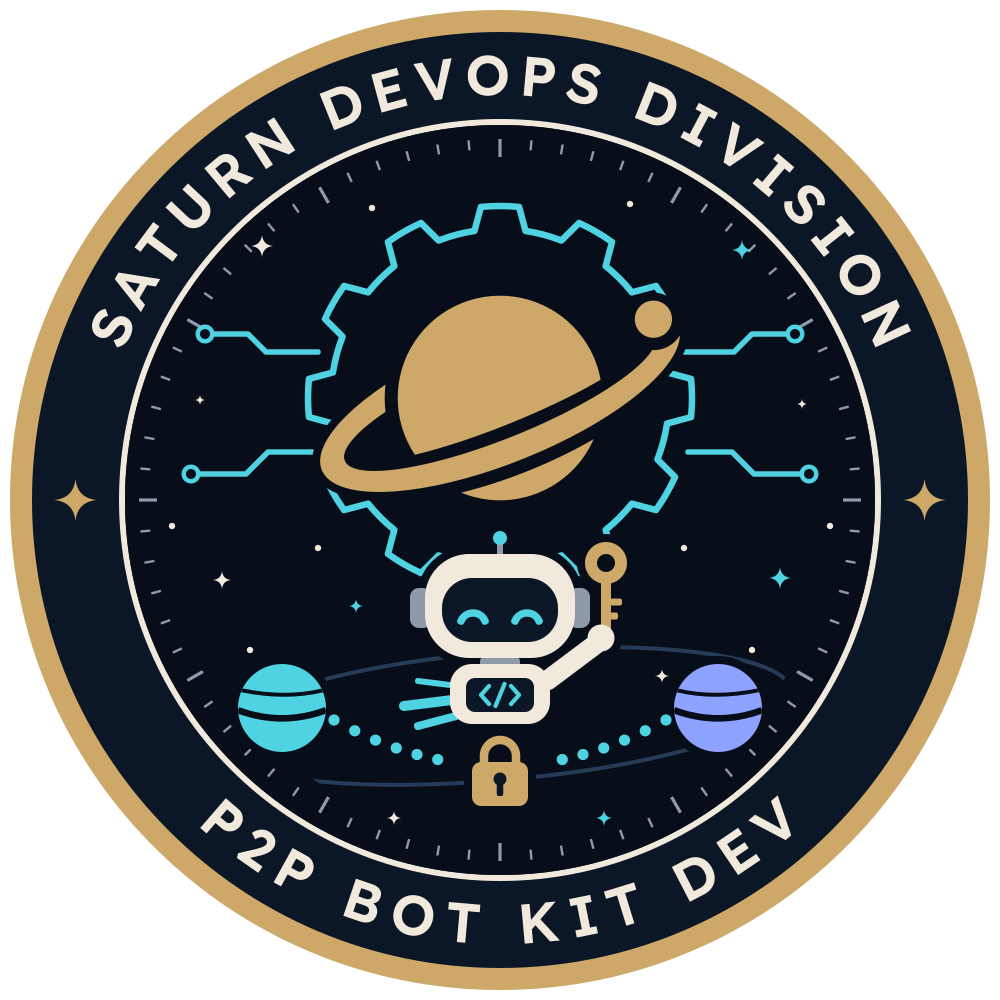

# P2P Bot Kit DEV: brand files

  

The badge of the Saturn P2P Bot Kit, issued by the Saturn DevOps Division: a
round mission patch in the Saturn Navigator colours. The Saturn Ringlight mark
sits over a cyan gear. Under it the kit's bot flies with its own key, because
every bot runs on its owner's machine with its owner's keys. The two planets
are the two chains of a swap, and the dotted bridge with the gold padlock is
the hash-lock on both chains that secures every swap on the P2P board.

| File | What it is for |
|---|---|
| `P2PBotKit_Patch_Color.svg` | The patch, the hero: READMEs, kit pages, stickers. 160 px wide or more. |
| `P2PBotKit_Mark_Color.svg` | The emblem without words: avatars and small spaces. 96 px or more. |
| `P2PBotKit_Horizontal_Color.svg` | Mark, name and tagline in one line, for dark backgrounds. 320 px wide or more. |
| `P2PBotKit_Horizontal_Color-Light.svg` | The same, for light backgrounds. |
| `favicon.svg` | The bot's face in a gold rim, for browser tabs and app icons (16 to 180 px). |
| `p2p-bot-kit-colors.css`, `p2p-bot-kit-colors.json` | The colours, as CSS variables and as data. |

Every logo in every colourway (Color, Color-Light, Ivory, White, Navy and
Black) as SVG and PNG, the icons and the brand sheet are on the Saturn media
page: https://ops.saturnx.cc/media#p2p

## Using them

- Keep the colours flat: no gradients, glows or shadows.
- Don't stretch, rotate, redraw or recolour a logo outside the palette, and
  never move the moon.
- Keep clear space around the patch or the mark of one eighth of its width,
  and around a name lockup of the height of the P in P2P.

| Colour | Hex | Where |
|---|---|---|
| Navy | `#0B1626` | The word band, lockup backgrounds, the bot's visor |
| Space | `#070E1A` | The patch field |
| Ivory | `#F1EADC` | The words, the bot |
| Gold | `#CDA869` | The rim, the Saturn mark, the key, the padlock |
| Cyan | `#4FD3E3` | The gear, the circuits, the bridge, the bot's eyes |
| Slate | `#8E99AA` | The bezel ticks |
| Periwinkle | `#8EA2FF` | The second planet |
| Line | `#253B56` | The orbit line |

Fonts: Lexend SemiBold for the names and JetBrains Mono for the tagline, both
under the SIL Open Font License. The text in every logo file is outlined, so no
font is needed to show them.

## Not covered by the MIT License

The MIT License in `../LICENSE` covers the kit's code and documentation. These
logos are the Saturn P2P Bot Kit's marks: use them to refer to the kit, unaltered,
and not in a way that suggests endorsement, partnership or affiliation. The
disclaimer at https://ops.saturnx.cc/media#disclaimer applies.
